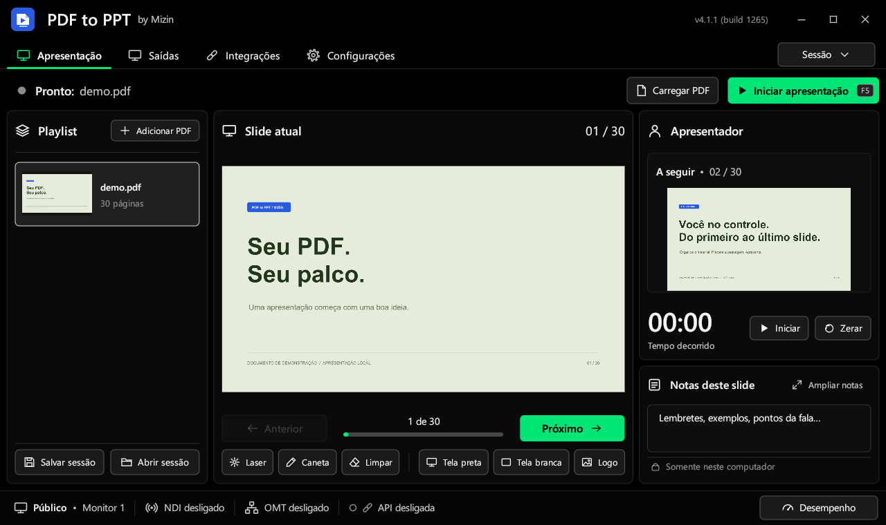

# PDF to PPT by Mizin

Apresentador de PDF para Windows: playlist de PDFs, tela do público e tela do apresentador
com notas, próximo slide e cronômetro, saídas **NDI®** e **OMT**, controle pelo celular,
atalhos para Stream Deck e API local para integração com outros sistemas.



Site oficial, tutoriais e vídeos: **https://pdftopptmizin.pages.dev**

> Este repositório guarda só os **downloads** (espelho do site). O código-fonte não é público.

## Baixar

Abra a [release mais recente](../../releases/latest) e escolha um dos arquivos:

| Arquivo | Para quem |
| :--- | :--- |
| `PDFtoPPT-Setup-vX.Y.Z-buildNNNN.exe` | **Recomendado.** Instala no Windows, com atalho no menu Iniciar. Não pede administrador. |
| `PDFtoPPT-Portable-vX.Y.Z-buildNNNN.zip` | Versão portátil: extraia a pasta inteira e abra `PDFtoPPT.exe`. |

São **os mesmos arquivos** do site, com o mesmo SHA-256 (está na descrição de cada release).
Use o GitHub quando o download pelo site estiver lento ou bloqueado na sua rede.

## Atualizações

O aplicativo avisa quando sai uma versão nova. Com um clique ele baixa, confere o SHA-256,
fecha, instala e abre de novo na versão nova, tanto no instalador quanto no portátil.
Arquivos antigos que a versão nova não usa são removidos; PDFs, sessões e configurações
são mantidos. Nada é instalado sem você clicar.

## Requisitos

- Windows 10 ou 11, 64 bits

## Conferir o arquivo baixado

No PowerShell, na pasta do download:

```powershell
Get-FileHash .\PDFtoPPT-Setup-v4.1.1-build1265.exe
```

O resultado tem que ser igual ao SHA-256 publicado na release e no site.

## Antivírus

Os pacotes não têm assinatura digital comercial, então o SmartScreen pode avisar na primeira
execução. **Não desative o antivírus.** Se houver detecção de ameaça, interrompa a execução e
informe pelo site.

## Licenças

PDFium, runtime NDI® e codec VMX/OMT acompanham o pacote, com as licenças na pasta `licenses`.
NDI® is a registered trademark of Vizrt NDI AB.

## Contato

Mizin · https://pdftopptmizin.pages.dev

Software proprietário. Todos os direitos reservados.
